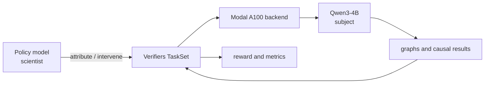

# BioCircuit

BioCircuit is a research environment for testing whether an AI policy can turn attribution-graph hypotheses into causal experiments on **Qwen3-4B**, the subject model. The policy is the scientist: it reads compact graph views, chooses stable features, invokes experiments, and returns a circuit. The subject supplies generations, graphs, and intervention results; it is not the policy being trained or evaluated.

## Three tasks

| TaskSet ID | What the policy sees | What grading asks |
|---|---|---|
| `circuit-supernodes` | Five labeled examples | Discover a stable semantic supernode; ablation must affect visible and held-out positives but preserve controls |
| `supernode-rediscovery` | A goal name, no example prompts | Rediscover a goal mechanism across a hidden positive cohort and controls |
| `suppressed-features` | A corrupted family name | Reverse hidden corruption and recover the clean output distribution |

## Artifact status

| Artifact | Availability |
|---|---|
| Visible one-row `heldout-cohorts.jsonl.gz` | Checked in with Git LFS; legacy smoke fixture (about 293 MB compressed, about 1.97 GB expanded) |
| Visible training data | Not shipped; generate it |
| Rediscovery train/eval data | Not shipped; generate it |
| Restoration train/eval data | Not shipped; generate it |

The checked-in sidecar is a legacy smoke-fixture manifest and remains supported. Manifests record provenance; runtime loaders do not automatically authenticate or validate them.

## Start here

Prerequisites are Python 3.13 for the root project, Python 3.11–3.13 for the nested package, `uv`, Git LFS, Modal credentials, and Prime credentials for online policy evaluation. GPU/API workflows cost money.

- [Quickstart](quickstart.md) — clone to one visible rollout
- [Documentation by role](docs/README.md)
- [Operations](docs/operations.md) and [reference](docs/reference.md)
- [How BioCircuit works](docs/blog/how-biocircuit-works.md)
- [Contributing](CONTRIBUTING.md)
