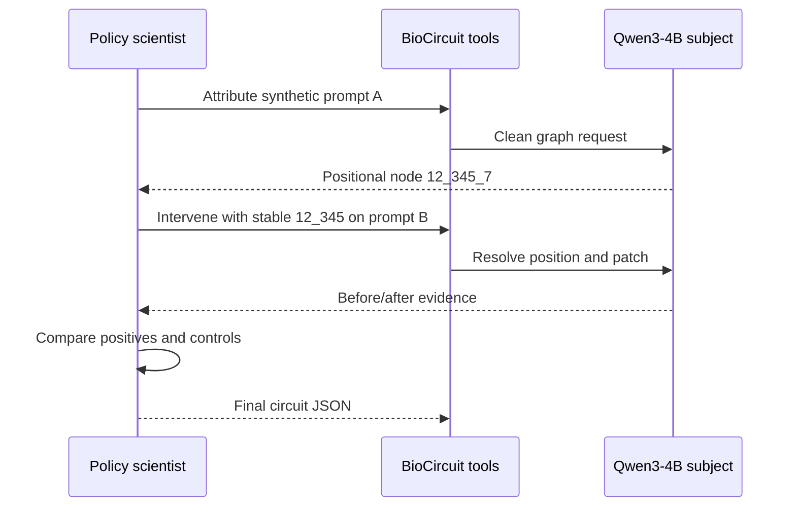
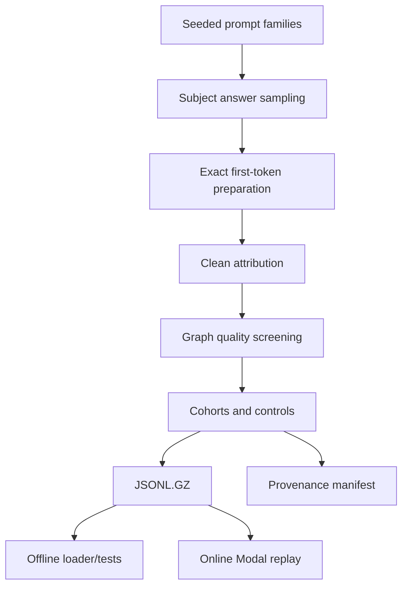

# From Attribution Graphs to Causal Experiments: How BioCircuit Works

BioCircuit casts a policy model as a scientist studying another model. The scientist may be trained or evaluated through Prime and Verifiers. Its subject is Qwen3-4B, served behind a Modal A100 backend with a fixed transcoder set. Keeping those roles separate matters: a clever policy is rewarded for designing causal tests, not for being the model whose internals are patched.

## Attribution is a hypothesis, not a verdict

An attribution graph says which internal features influenced an output under a pruned graph construction. It does not prove that a feature is necessary, specific to the concept, or sufficient to explain meaning. BioCircuit therefore gives the policy two conceptual moves: attribute an arbitrary prompt, then intervene with selected features on an arbitrary prompt. A complete loop is: form a hypothesis, inspect more prompts, transfer stable features, ablate positives, test controls, revise, and finally submit JSON.

Consider a synthetic feature visible as node `12_345_7`: layer 12, feature 345, token position 7. The policy submits only `12_345`. On another prompt the same learned feature might occur at position 2, so BioCircuit independently resolves it to `12_345_2`. This stable identity is what makes cross-prompt experiments possible.



## Three views of discovery

Visible discovery supplies five examples from one semantic goal. The policy must find a supernode that survives transfer to held-out examples. Promptless rediscovery names the goal but hides every cohort prompt, forcing the policy to generate its own probes. Suppressed-feature restoration names a corrupted family. Its attribution view remains a clean graph with output nodes and edges redacted; corruption appears only inside intervention experiments and grading replay.

For discovery, a submitted finite factor `r` is negated during ablation. A necessary circuit should disrupt the original top token on positive examples. Specificity comes from the paired control test: the same intervention should preserve unrelated controls. Passing only the positive test can identify a generic language mechanism rather than the claimed concept.

Restoration has a different algebra. If clean activation is `a`, hidden corruption is `c`, and the policy proposes `r`, the experiment composes them directly as `a × c × r`. The grader requires the clean target to return to the top, then scores distributional recovery as `exp(-KL(clean || restored))`; otherwise the score is zero. This rewards restoring more than one token while gating on the intended outcome.

```mermaid
flowchart LR
  C[Clean activation a] --> X[hidden corruption × c]
  X --> Y[policy restoration × r]
  Y --> O[restored logits]
  O --> G{clean target top?}
  G -->|no| Z[0]
  G -->|yes| K[exp -KL clean || restored]
```

## From prompts to cohorts

Builders seed prompt generation across semantic families, ask the subject to sample bounded answers, retain attributable first tokens, build maximal graphs, and screen graph error influence. They then form same-goal positives and different-goal controls. Restoration additionally searches for a shared corruption that changes every cohort member. The output is compact runtime data plus a provenance sidecar.



## Engineering boundaries and limitations

Modal owns GPU subject execution; Hugging Face hosts the three evaluation datasets; Prime/Verifiers owns policy rollouts; Neuronpedia labels are optional enrichment, never grading truth. Operational commands belong in [operations](../operations.md), schemas in [reference](../reference.md), and artifact generation in [data generation](../data-generation.md).

The method is costly and sensitive to pruning. A stable feature may be absent from a prompt, graph thresholds may hide useful structure, and subject/transcoder/provider versions can drift. “Hidden” means hidden from policy messages and tools, not encrypted from operators or stored task rows. Finally, disrupting a top token is evidence of causal necessity under this intervention, rather than proof of a complete semantic explanation. Local ignored outputs must not be promoted into benchmark claims.
