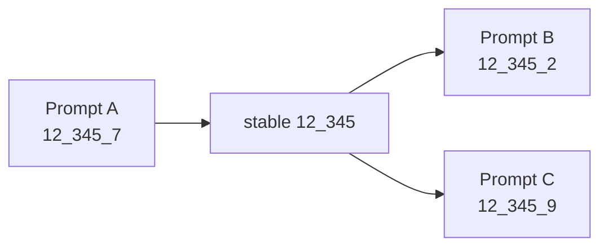

# Reference

## Stable identities and coordinates

A policy submits `layer_feature`, such as `12_345`. A stored graph node is `layer_feature_position`, such as `12_345_7`. Resolution is performed independently against every prompt graph, normally selecting that stable feature's highest-ranked occurrence. A feature can therefore transfer across prompt positions.

Policy factors accept any finite float, including `0.0`. Discovery grading negates each factor before intervention. Restoration composes the hidden corruption and submitted restoration directly in the backend as `a × c × r`; it does not negate restoration factors.



## Policy tools

`attribute_circuit(prompt, feature_count=60)` attributes any prompt and returns a rendered graph view plus available/returned feature counts. `intervene_circuit(prompt, nodes)` resolves submitted stable IDs in that prompt and returns before/after subject behavior. Names are public policy interfaces; implementation helpers and backend payload details are internal.

## Accepted final JSON

Either a named group form:

```json
{"supernodes":[{"name":"comparison","nodes":["12_345",{"id":"18_9","intervention_weight":0.5}],"intervention_weight":1.0}]}
```

or, where the TaskSet permits it, a flat restoration form:

```json
{"nodes":[{"id":"12_345","intervention_weight":0.5}]}
```

The parser extracts the last complete top-level JSON object. Incoming normalization currently ignores unrelated extra fields while constructing the canonical form. The canonical `Circuit`, `CircuitDatasetRow`, and dataset examples remain strict and reject extras. Up to eight groups and sixty unique stable features are accepted; duplicate features are rejected.

## Dataset schema and files

Every row has `family`, optional `goal`, and lists `example_prompts`, `heldout_prompts`, and `control_prompts`. Each example has `prompt`, `target_token`, a graph, and optional corruption tuples `(layer, feature, position, factor)`.

| TaskSet | Default eval file | Default train file |
|---|---|---|
| `circuit-supernodes` | `visible_dataset/heldout-cohorts.jsonl.gz` | `visible_dataset/train-cohorts.jsonl.gz` |
| `supernode-rediscovery` | `supernode_rediscovery/promptless-supernodes.jsonl.gz` | `promptless-supernodes-train.jsonl.gz` |
| `suppressed-features` | `output_restoration/suppressed-features.jsonl.gz` | `suppressed-features-train.jsonl.gz` |

Only the visible eval file is shipped.

## Manifest versions

Sidecars record dataset schema and generation-policy versions, row count and SHA-256; subject model, transcoder set, node/edge thresholds and backend; sampler and generator settings; screening; and aggregate graph quality. The checked-in visible sidecar is legacy data and remains supported. Manifests are provenance sidecars, not runtime admission checks.

## Modal RPCs

`sample_until_answer`, `attribute_prompt`, `evaluate_ablation_cohort`, `test_corruption_coordinates`, and `restore_output` are internal RPCs. Policy-facing tools are the stable public boundary. Config `[taskset]` selects an ID, dataset and grader thresholds; `[taskset.subject]` selects model/transcoder/pruning. Changing those values changes provenance and may change scientific results.

## Threat boundary

“Hidden” means omitted from policy messages and tools. Operators, Modal code, graders, and stored task data can access it; it is not encrypted. Restoration attribution uses a clean graph with output nodes/edges redacted. Hidden corruption is applied only during intervention experiments and grading replay.
